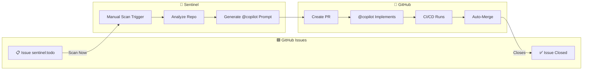
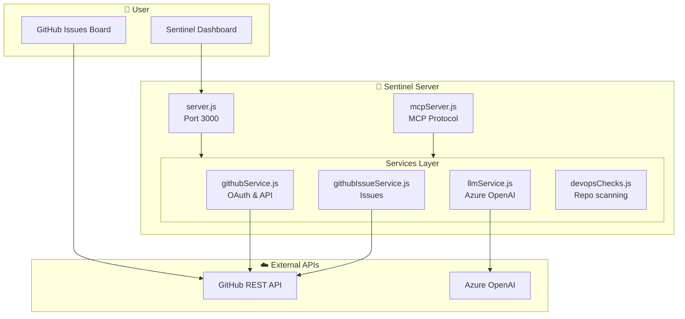
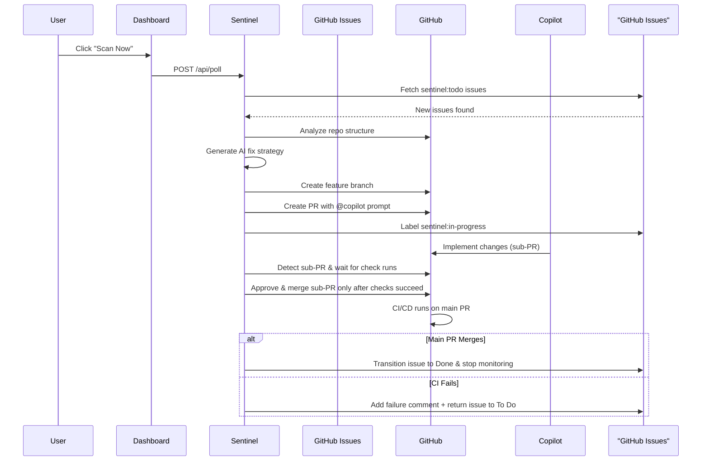

# Sentinel 🛡️

> **Autonomous DevOps Orchestrator — GitHub Issues → GitHub PRs**

[](https://sentineldevagent.azurewebsites.net)
[](https://github.com/apps/sentinel-devops-automation-agent)

Sentinel monitors GitHub Issues, automatically creates Pull Requests with CI/CD workflows, and uses AI to implement issue requirements—closing the loop from "sentinel:todo" to "Done" with minimal human intervention. Scans are triggered manually via the **Scan Now** button in the dashboard, or via the `/api/poll` endpoint.

Deployment is via the included GitHub Actions workflow (`.github/workflows/deploy-azure.yml`), which builds the Docker image and deploys it to Azure Web Apps. There is no one-click ARM deploy template.

---

## How It Works



---

## Screenshots

_Screenshots will be added as the UI stabilizes. To preview the dashboard locally, start the server and open <http://localhost:3000>._

---

## Key Features

| Feature | Description |
|---------|-------------|
| **Manual Scan** | Trigger a GitHub Issues scan on demand via the **Scan Now** button or `POST /api/poll` |
| **Per-Operator Token Isolation** | Multiple operators can sign in simultaneously. Each operator's OAuth token is scoped to their own background work via async context — there is no single shared global token. Dashboard operations state (queue, logs, history) is shared; this is per-operator token isolation, not full multi-tenant data isolation |
| **Authenticated API** | In production, state-changing and sensitive API routes require an authenticated GitHub OAuth session (or GitHub App mode, or an internal token header for MCP-triggered calls). `/api/status` returns a safe status DTO — it never returns OAuth tokens |
| **Per-User OAuth** | Uses GitHub OAuth to perform actions as the logged-in user. The OAuth `state` parameter is generated with cryptographic randomness and verified on callback |
| **AI Analysis** | Uses Azure OpenAI to analyze repos and plan fixes |
| **Smart Detection** | Auto-detects Node/Python/.NET/Java from repo files |
| **@copilot Integration** | Posts context-aware prompts to trigger GitHub Copilot |
| **Secret Placeholders** | Uses `${{ secrets.X }}` in workflows—never exposes values |
| **Sub-PR Management** | Detects Copilot-generated PRs, waits for successful check runs, then approves and merges them. There is no immediate-merge fallback when checks have not passed |
| **Closed-Loop Lifecycle** | When the main PR merges, the source issue is transitioned to **Done** and monitoring stops. On CI failure, the issue is commented with the failure details and returned to **To Do** |
| **Repo Allowlist** | Target repos are restricted by `ALLOWED_REPOS` / `ALLOWED_ORGS` (see Environment Variables). The target repo comes only from the issue's `repo:` directive or `DEFAULT_REPO` — Sentinel does not guess a repo from free text in the issue |
| **Issue Directives** | `repo:`, `language:`, `build:`, `test:`, and `deploy:` directives in the issue body are honoured, including custom build/test/deploy commands |
| **Live Dashboard** | Real-time UI with phase indicator, terminal feed, agent badge, and inspection panel |
| **Repo Inspection** | On-demand repo health scan that auto-creates a GitHub Issue with findings |
| **Cloud Deployment** | Azure Web App deployment with Docker support |
| **MCP Server** | Exposes tools for AI agents (Claude, VS Code Copilot) |

---

## Architecture



---

## Quick Start

### 1. Install
```bash
git clone https://github.com/Unigalactix/SENTINEL.git
cd SENTINEL
npm install
```

### 2. Configure `.env`
```env
# GitHub OAuth (Required for Per-User Auth)
OAUTH_CLIENT_ID=your_client_id
OAUTH_CLIENT_SECRET=your_client_secret

# GitHub Issues (Required)
GITHUB_ISSUES_REPO=owner/repo          # Repository to poll for sentinel:todo issues
GITHUB_ISSUES_LABEL=sentinel:todo      # Label that marks issues for processing (default: sentinel:todo)
GHUB_TOKEN=ghp_...                     # Personal access token (fallback when no OAuth user)
GHUB_ORG=YourOrg                       # GitHub organization for PR reconciliation

# AI (Optional — enables agentic analysis)
LLM_API_KEY=your_azure_openai_key
LLM_ENDPOINT=https://your-resource.openai.azure.com
LLM_DEPLOYMENT_NAME=gpt-4o
USE_GH_COPILOT=true

# Session & Runtime
NODE_ENV=production                    # Set to production in deployed environments (the Dockerfile and the Azure workflow do this)
SESSION_SECRET=your_random_secret      # REQUIRED in production: at least 16 characters, not a built-in default — the server refuses to boot without a strong value

# Target Repo Allowlist (optional)
ALLOWED_ORGS=                          # Comma-separated GitHub orgs/owners whose repos may be targeted
ALLOWED_REPOS=                         # Comma-separated owner/repo entries that may be targeted
DEFAULT_REPO=owner/repo                # Fallback target repo when an issue has no repo: directive

# Internal / MCP access (optional)
SENTINEL_INTERNAL_TOKEN=               # Shared secret the MCP server sends as an internal token header so trigger_manual_poll can call the production API
SENTINEL_ALLOW_DESTRUCTIVE=false       # Default false. Set to true only to enable the destructive MCP/LLM tools (merge_pr, delete_branch)

# Post-PR Status (optional)
POST_PR_STATUS=In Progress             # Status applied to an issue after its PR is created; can be overridden per repo in config/board_post_pr_status.json (keys are repo full names, owner/repo)
```

#### Environment Variables

| Variable | Required | Description |
|----------|----------|-------------|
| `NODE_ENV` | In production | Must be `production` in deployed environments. It is set by the Dockerfile and by the Azure deploy workflow. In production, runtime config editing (`POST /api/config`) and the MCP Inspector stay disabled. |
| `SESSION_SECRET` | **Yes, in production** | Session signing secret, at least 16 characters and not the old built-in default value. Production refuses to boot without a strong `SESSION_SECRET`. |
| `OAUTH_CLIENT_ID` / `OAUTH_CLIENT_SECRET` | Yes (OAuth mode) | GitHub OAuth App credentials. The OAuth `state` parameter is generated with `crypto` and verified on callback. |
| `GITHUB_ISSUES_REPO` | Yes | `owner/repo` that Sentinel reads `sentinel:todo` issues from and writes updates to. The deploy workflow fails if this secret is empty. |
| `GITHUB_ISSUES_LABEL` | No | Label that marks issues for processing (default: `sentinel:todo`). |
| `GHUB_TOKEN` | No | Personal access token fallback when no OAuth user / GitHub App is available. |
| `ALLOWED_ORGS` | No | Comma-separated allowlist of GitHub orgs/owners whose repos Sentinel may target. |
| `ALLOWED_REPOS` | No | Comma-separated allowlist of `owner/repo` targets. If neither allowlist is set, the default is repos owned by the issues-repo owner or by the signed-in operator. |
| `DEFAULT_REPO` | No | Fallback target repo when an issue has no `repo:` directive. No repo is ever guessed from free text in the issue body. |
| `SENTINEL_INTERNAL_TOKEN` | No | Optional shared secret. When set, the MCP server's `trigger_manual_poll` tool sends it as an internal token header so it can call the production API, which otherwise requires an authenticated session. |
| `SENTINEL_ALLOW_DESTRUCTIVE` | No | Default `false`. Must be explicitly set to `true` to enable the destructive MCP/LLM tools `merge_pr` and `delete_branch`. |
| `POST_PR_STATUS` | No | Status applied to an issue after its PR is created. Can be overridden per repo in the optional `config/board_post_pr_status.json`, keyed by repo full name (`owner/repo`). |
| `LLM_API_KEY` / `LLM_ENDPOINT` / `LLM_DEPLOYMENT_NAME` | No | Azure OpenAI configuration for optional agentic analysis. |
| `USE_GH_COPILOT` | No | Enables GitHub Copilot-oriented prompting where configured. |

### 3. Run
```bash
npm start          # Start server at http://localhost:3000
npm run start:mcp  # Start MCP server for AI agents
```

---

## Project Structure

```
SENTINEL/
├── server.js              # Main orchestrator (manual scan, authenticated API, per-operator token context)
├── mcpServer.js           # MCP server for AI agents
├── CHANGELOG.md           # Version history & change tracking
├── public/
│   └── index.html         # Live dashboard UI (Scan Now, feed, agent badge)
├── src/
│   ├── services/
│   │   ├── githubService.js       # GitHub API (42+ exports, PR management)
│   │   ├── githubIssueService.js  # GitHub Issues API (poll, create, update, comment)
│   │   ├── authService.js         # OAuth handling
│   │   ├── llmService.js          # Azure OpenAI integration
│   │   └── devopsChecks.js        # Repo scanning
│   └── tools/
│       └── definitions.js         # MCP tool definitions
├── scripts/
│   └── inspect_repo.js    # Standalone repo inspector (creates GitHub Issues with findings)
├── __tests__/
│   └── exports.test.js    # Export verification tests
├── config/
│   └── board_post_pr_status.json
├── docs/                  # Project documentation
│   ├── agents.md          # Agent architecture & changelog reminder
│   ├── github-issues-setup.md  # GitHub Issues labels & config guide
│   ├── DETAILED_WORKFLOW.md
│   ├── PROJECT_REPORT.md
│   ├── workflow-flow.md
│   ├── suggestions.md
│   └── vscode_integration.md
├── logs/
│   └── server.log
└── Dockerfile             # Container definition
```

---

## Workflow Lifecycle



---

## @copilot Prompt Format

Sentinel generates **context-aware prompts** (not hardcoded YAML):

```markdown
@copilot /fix **GH-123: Add user authentication**

[Description from GitHub Issue]

---
## 🤖 AI Analysis
[AI-generated fix strategy based on repo analysis]

---
## Repository Context
| Property | Value |
|----------|-------|
| **Repo** | Org/RepoName |
| **Language** | node |
| **Available Secrets** | ${{ secrets.ACR_LOGIN_SERVER }}, ... |

> **Note:** This repository already has a CI/CD workflow.

## Guidelines
1. Read the entire repository first
2. Use secret placeholders—never hardcode values
3. Only create workflows if needed
```

---

## NPM Scripts

| Command | Description |
|---------|-------------|
| `npm start` | Run the server |
| `npm run start:mcp` | Run MCP server for AI agents |
| `npm test` | Run all Jest tests |
| `npm run test:exports` | Verify all function exports |
| `npm run lint` | Run ESLint |
| `npm run verify` | Lint + export tests |

---

## MCP Integration

Add to Claude Desktop's `config.json`:

```json
{
  "mcpServers": {
    "sentinel": {
      "command": "node",
      "args": ["C:/path/to/SENTINEL/mcpServer.js"]
    }
  }
}
```

**Available Resources:**
- `sentinel://status` — Live system status (resource). Returns the same safe status DTO as `/api/status` — no OAuth tokens are ever included.

**Available Tools:**
- `read_server_logs` — Read recent server log lines
- `trigger_manual_poll` — Trigger a manual scan for `sentinel:todo` issues. Against a deployed (production) instance it sends the `SENTINEL_INTERNAL_TOKEN` internal token header, since the API otherwise requires an authenticated session
- `get_github_issue` — Read the full details of a GitHub Issue
- `add_github_issue_comment` — Post a comment to a GitHub Issue
- `check_pr_status` — Check the CI/check-run status of a Pull Request
- `generate_workflow_yaml` — Generate CI/CD workflow YAML
- `list_active_repos` — List the repositories/projects currently being monitored
- `undraft_pr` — Mark a draft Pull Request as ready for review
- `merge_pr` — ⚠️ **Destructive.** Merge a Pull Request. Disabled unless `SENTINEL_ALLOW_DESTRUCTIVE=true`
- `delete_branch` — ⚠️ **Destructive.** Delete a branch. Disabled unless `SENTINEL_ALLOW_DESTRUCTIVE=true`

---

## GitHub Secrets for Workflows

| Secret | Purpose |
|--------|---------|
| `ACR_LOGIN_SERVER` | Azure Container Registry URL |
| `ACR_USERNAME` | ACR username |
| `ACR_PASSWORD` | ACR password |
| `AZURE_WEBAPP_APP_NAME` | Web App name |
| `AZURE_WEBAPP_PUBLISH_PROFILE` | Publish profile XML |
| `OAUTH_CLIENT_ID` | GitHub OAuth App Client ID |
| `OAUTH_CLIENT_SECRET` | GitHub OAuth App Client Secret |
| `GITHUB_ISSUES_REPO` | `owner/repo` for the issues board (**required** — the deploy workflow fails if this secret is empty) |
| `GITHUB_ISSUES_LABEL` | Label for pending issues (default: `sentinel:todo`) |
| `LLM_API_KEY` | Azure OpenAI API Key |
| `LLM_ENDPOINT` | Azure OpenAI endpoint URL |
| `SESSION_SECRET` | Session signing secret (**required in production**, at least 16 characters; the server refuses to boot without a strong value) |
| `SENTINEL_INTERNAL_TOKEN` | Optional shared secret the MCP server uses as an internal token header to trigger scans against the deployed instance |

> The deploy workflow also sets `NODE_ENV=production` as an app setting (not a secret) on the Azure Web App.

---

## Changelog

See [CHANGELOG.md](CHANGELOG.md) for version history and detailed change tracking.

---

## License

MIT — see [LICENSE](LICENSE).
