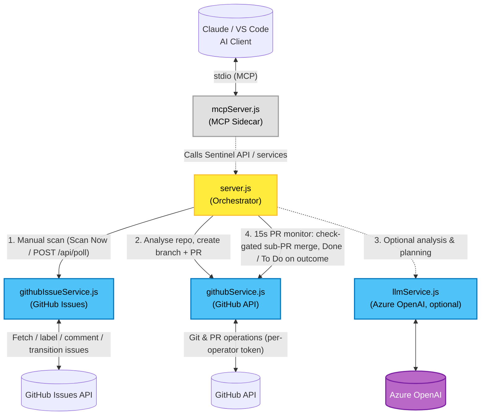

# Sentinel: Project Report

## Executive Summary

**What is this?**
Sentinel is an autonomous DevOps orchestrator that turns **GitHub Issues** into **GitHub Pull Requests**. There is no Jira integration and no `jiraService` — GitHub Issues is the ticket source, the tracking board, and the place Sentinel reports back to.

**Why does this matter?**
Software development involves repetitive steps: creating branches, scaffolding CI/CD workflows, prompting an AI coder, watching checks, and updating the ticket. Sentinel automates that loop so developers can focus on review and higher-level problem solving.

**The analogy**
Think of Sentinel as a junior DevOps engineer on call:

1. You file a GitHub Issue and label it `sentinel:todo`.
2. You press **Scan Now** (scans are manual — there is no automatic polling loop for new issues).
3. Sentinel analyses the target repo and plans the fix, optionally using Azure OpenAI.
4. It opens a Pull Request with a generated CI/CD workflow and a context-aware `@copilot` prompt.
5. A monitor watches the PR every 15 seconds. Copilot sub-PRs are approved and merged only after their check runs succeed.
6. When the main PR merges, the issue is transitioned to **Done**. If CI fails, the issue is commented and returned to **To Do**.

---

## The Workflow: Life of an Issue

### Phase 1: Trigger (Manual Scan)
* **Human action**: Create a GitHub Issue in the configured issues repo (`GITHUB_ISSUES_REPO`), label it `sentinel:todo`, and optionally add directives in the body: `repo:`, `language:`, `build:`, `test:`, `deploy:`.
* **System response**: Nothing happens until an operator clicks **Scan Now** in the dashboard or calls `POST /api/poll`. The scan fetches open issues with the configured label (default `sentinel:todo`).
* **Target repo**: Taken only from the issue's `repo:` directive or `DEFAULT_REPO`, and checked against the repo allowlist (`ALLOWED_REPOS` / `ALLOWED_ORGS`; by default, repos owned by the issues-repo owner or the signed-in operator).

### Phase 2: Analysis & PR Creation
* Sentinel detects the target repo's language and structure, lists available secret **names** (never values), and — if configured — uses Azure OpenAI (`llmService.js`) to summarise the repo and plan a fix strategy, posting that analysis as an issue comment.
* It creates a feature branch and a Pull Request containing a generated (or reused) CI/CD workflow and an `@copilot` prompt. The `build:`, `test:`, and `deploy:` issue directives control the generated workflow's commands and target.
* The issue is labelled `sentinel:in-progress`, and its post-PR status comes from `POST_PR_STATUS` or the per-repo override in `config/board_post_pr_status.json` (keyed by `owner/repo`).

### Phase 3: Monitoring (15-Second PR Monitor)
* A background monitor runs every 15 seconds for PRs Sentinel is already tracking. This is PR monitoring only — it does not scan for new issues.
* When GitHub Copilot opens a sub-PR against the feature branch, Sentinel undrafts it, waits for its check runs, and — only after the checks succeed — approves it and enables auto-merge. There is no immediate-merge fallback.

### Phase 4: Completion
* **Main PR merged**: The source issue is transitioned to **Done**, a success comment is posted, and monitoring for that issue stops.
* **CI failure**: The issue is commented with the failure details and returned to **To Do** so a human (or a later scan) can pick it up again.

---

## Authentication & Security Model

* **GitHub OAuth**: Operators sign in with GitHub OAuth. The OAuth `state` parameter is generated with `crypto` and verified on callback.
* **Per-operator token isolation**: Each signed-in operator's token is scoped to their own background work via async context — there is no single global token shared between operators. Multiple operators can be signed in at once. Dashboard operations state (queue, logs, history) is shared, so this is token isolation, not full multi-tenant data isolation.
* **Authenticated API**: In production, all state-changing and sensitive API routes require an authenticated GitHub OAuth session (or GitHub App mode, or an internal token header for MCP-triggered calls). `GET /api/status` returns a safe status DTO and never returns OAuth tokens.
* **Production hardening**: Production refuses to boot without a strong `SESSION_SECRET` (at least 16 characters, not a built-in default). `NODE_ENV=production` is set by the Dockerfile and the Azure workflow, and runtime config editing and the MCP Inspector stay disabled in production.
* **Destructive tools gated**: The MCP/LLM tools `merge_pr` and `delete_branch` are disabled unless `SENTINEL_ALLOW_DESTRUCTIVE=true`.

---

## The Dashboard

The web dashboard (served from `public/index.html`) is the operator's view:

* **Scan Now** button to trigger a manual issue scan, plus a pause/resume control.
* **Phase indicator and live terminal feed** showing what Sentinel is doing.
* **Queue and history** of processed issues and their PRs (shared operations state).
* **Repo inspection panel**: an on-demand repo health scan that files its findings as a new GitHub Issue.
* **Operator badge** showing who is signed in.

---

## MCP Server

`mcpServer.js` exposes Sentinel to AI clients (Claude Desktop, VS Code Copilot) over the Model Context Protocol:

* **Resource**: `sentinel://status`
* **Tools**: `generate_workflow_yaml`, `check_pr_status`, `add_github_issue_comment`, `undraft_pr`, `get_github_issue`, `read_server_logs`, `trigger_manual_poll`, `list_active_repos`, plus the destructive, gated `merge_pr` and `delete_branch`.

Against a deployed instance, `trigger_manual_poll` can send the `SENTINEL_INTERNAL_TOKEN` internal token header so it can call the production API.

---

## Technical Appendix

* **Server (`server.js`)**: Node.js / Express orchestrator — manual scans, the authenticated API, the dashboard, and the 15-second PR monitor.
* **GitHub Issue Service (`src/services/githubIssueService.js`)**: Reads, labels, comments on, and transitions GitHub Issues in `GITHUB_ISSUES_REPO`.
* **GitHub Service (`src/services/githubService.js`)**: GitHub API operations — repo analysis, branches, PRs, check runs, merges — performed with the current operator's token from async context.
* **Auth Service (`src/services/authService.js`)**: GitHub OAuth flow with verified `state`.
* **LLM Service (`src/services/llmService.js`)**: Optional Azure OpenAI integration for repo summarisation, fix planning, and workflow drafting.
* **DevOps Checks (`src/services/devopsChecks.js`)**: Repository health scanning used by the inspector.
* **MCP Server (`mcpServer.js`)**: MCP interface for external AI agents (see above).
* **Repo Inspector (`scripts/inspect_repo.js`)**: Standalone/on-demand repo audit that files findings as a GitHub Issue.

### Deployment
Sentinel ships as a Docker image (`node:20-alpine`, `NODE_ENV=production`) deployed to Azure Web Apps by `.github/workflows/deploy-azure.yml`. That workflow is gated on the CI workflow (`.github/workflows/ci.yml`: ESLint + Jest, 85 tests) and fails early if the `GITHUB_ISSUES_REPO` secret is empty.

### Glossary
* **Pull Request (PR)**: A proposal to merge code changes into a repository.
* **Sub-PR**: A PR opened by GitHub Copilot against Sentinel's feature branch.
* **OAuth**: Delegation protocol used to authenticate operators against GitHub.
* **MCP (Model Context Protocol)**: A standard way for AI models to talk to external tools and data.
* **Allowlist**: The `ALLOWED_REPOS` / `ALLOWED_ORGS` restriction on which repositories Sentinel may target.

### System Architecture

