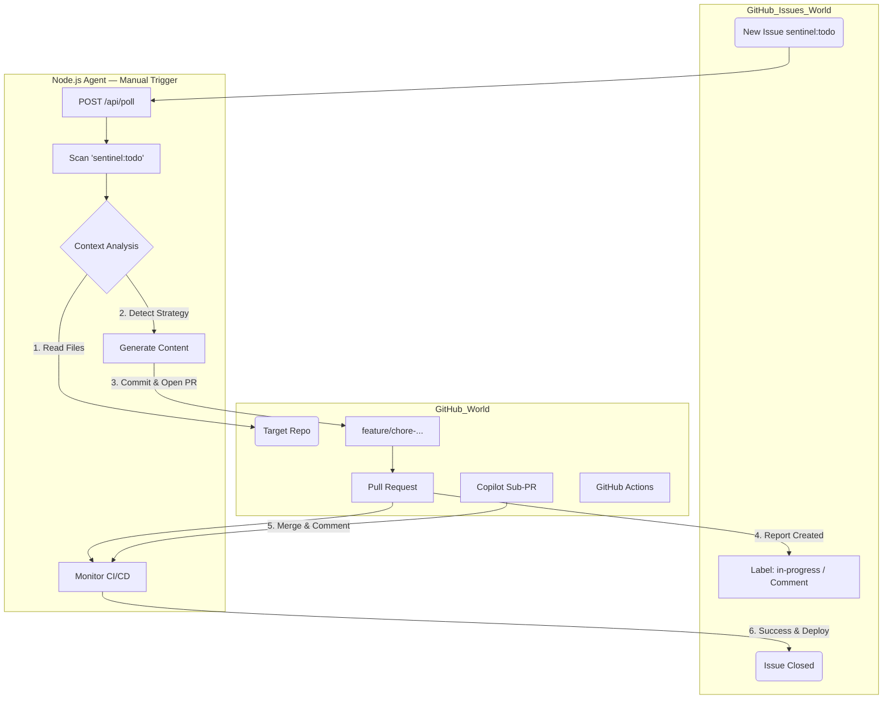

# Agents & Architecture Reference

This document serves as the technical specification for the Autonomous Agents and Interfaces in this system.

## 1. Sentinel Agent
**Runtime**: Node.js (`server.js`)
**Role**: DevOps Engineer
**Trigger**: Manual — via **Scan Now** dashboard button or `POST /api/poll`

### Core Workflow
The agent operates as a one-shot scan triggered by the user or the API:
1.  **Scan**: Fetches open issues from GitHub Issues (configurable repo + label, default `sentinel:todo`).
2.  **Prioritize**: Sorts issues by Priority (Highest → Lowest).
3.  **Process**: Picks the top issue and labels it **`sentinel:in-progress`**.
4.  **Agentic Analysis**: Uses Azure OpenAI to discover secrets, summarize the repo, and plan the fix.
5.  **Execute**: Generates Custom Workflow (if needed) or creates Pull Request.
6.  **Report**:
    -   **Success**: Comments with PR Link → Closes the issue (`sentinel:in-progress` removed).
    -   **Failure**: Comments with Error Log → Re-labels as `sentinel:todo`.

### Integration Specifications

#### GitHub Issue Field Mapping
The agent reads directives from the issue body (plain text lines):
-   `repo:` / `repoName:` — Target GitHub Repository (e.g., `Unigalactix/sample-node-project`).
-   `language:` — Project tech stack (`node`, `python`, `dotnet`, `java`).
-   `build:` — Custom build command (e.g., `npm run build:prod`).
-   `test:` — Custom test command.
-   `deploy:` — Deployment target (`azure-webapp`, `docker`).

#### Context Awareness (Discovery Priority)
The agent determines how to build/test a project using this strict precedence order:
1.  **GitHub Issue**: Explicit body directives override everything.
2.  **Instructions File**: Regex parsing of `.github/instructions.md`, `.github/agents.md`, or `README.md`.
    -   *Pattern*: `Build Command: "..."`
3.  **Deep Code Analysis**: Scanning specific files:
    -   `package.json` (Scripts: `build`, `test`, `start`)
    -   `pom.xml` / `build.gradle` (Maven/Gradle wrappers)
    -   `*.sln` / `*.csproj` (.NET)
    -   `requirements.txt` / `manage.py` (Python)
4.  **Language Defaults**: Fallback commands (e.g., `npm run build`).

### Construction & Deployment
-   **Branching Strategy**: Creates a stable feature branch named `chore/{issue-key}-workflow-setup`.
-   **Containerization**: Automatically generates and commits a `Dockerfile` if `deploy=azure-webapp` or `docker`.
-   **Pull Request Generation**:
    -   **Title**: `{ISSUE_KEY}: Enable CI/CD for {LANG}`
    -   **Body**: Auto-generated description including an **embedded Copilot Prompt** (`@copilot /fix ...`) to request further refinements.
-   **Secrets Management**:
    -   `ACR_LOGIN_SERVER`, `ACR_USERNAME`, `ACR_PASSWORD` (For Docker builds).
    -   `AZURE_WEBAPP_PUBLISH_PROFILE` (For Web App deployment).
    -   `OAUTH_CLIENT_ID`, `OAUTH_CLIENT_SECRET` (For GitHub OAuth).

---

## 2. Azure OpenAI Integration (Agentic Code)
**Module**: `src/services/llmService.js`
**Role**: Cognitive Engine

The agent uses Azure OpenAI to "reason" about the task before execution.

### Capabilities
1.  **Repo Summarization**: `summarizeRepo()` - Reads file structure and README.
2.  **Fix Planning**: `planFix()` - Correlates GitHub Issue with Repo Summary.
3.  **Workflow Generation**: `generateDraftWorkflow()` - Creates YAML based on the plan and **Available Secrets**.

### Configuration via `.env`
```env
LLM_API_KEY=...
LLM_ENDPOINT=...
LLM_DEPLOYEMENT_NAME=...
```

---

## 3. Model Context Protocol (MCP) Interface
**Runtime**: Node.js (`mcpServer.js`)
**Role**: AI Interoperability Layer

This server exposes the internal tools of the automation service to external AI agents (like Claude Desktop).

### Exposed Tools & Resources

#### `sentinel://status` (Resource)
Returns a live JSON snapshot of the system state:
-   Active Queue
-   Processing Phase
-   Recent Scan History

#### `generate_workflow_yaml` (Tool)
**Description**: Generates a GitHub Actions CI pipeline YAML for a specific language.
**Parameters**:
-   `language`: `node` | `python` | `dotnet`
-   `repoName`: String
-   `buildCommand`: String (Optional)
-   `testCommand`: String (Optional)
-   `deployTarget`: String (Optional)

#### `check_pr_status` (Tool)
**Description**: Checks the live CI/CD status (Check Runs) of a specific PR or Branch.
**Parameters**:
-   `repoName`: String
-   `ref`: Branch name or Commit SHA

#### Other Tools
-   `read_server_logs`: Read recent server log lines.
-   `trigger_manual_poll`: Trigger a manual scan for `sentinel:todo` issues. Against a deployed instance it sends the `SENTINEL_INTERNAL_TOKEN` internal token header, since the production API requires an authenticated session.
-   `get_github_issue`: Read the full details of a GitHub Issue.
-   `add_github_issue_comment`: Post a comment to a GitHub Issue.
-   `list_active_repos`: List the repositories/projects currently being monitored.
-   `undraft_pr`: Mark a draft Pull Request as ready for review.
-   `merge_pr`: ⚠️ **Destructive** — merge a Pull Request. Disabled unless `SENTINEL_ALLOW_DESTRUCTIVE=true`.
-   `delete_branch`: ⚠️ **Destructive** — delete a branch. Disabled unless `SENTINEL_ALLOW_DESTRUCTIVE=true`.

---

## Agent Workflow Diagram



---

## 4. Per-Operator Token Isolation
**Module**: `server.js` + `src/services/authService.js`  
**Role**: Concurrent Operator Session Management

The system supports multiple signed-in operators simultaneously, but there is **no single global token**. Each operator signs in with GitHub OAuth (the `state` parameter is generated with `crypto` and verified on callback), and that operator's token is scoped to their own background work via **async context**: scans, monitoring, and API calls made on behalf of an operator run with that operator's token, and one operator's sign-in or sign-out does not hand their token to another operator's work.

This is per-operator **token** isolation, not full multi-tenant data isolation: dashboard operations state (queue, logs, history) is shared between signed-in operators.

### API Access (`/api/status` and friends)
- In production, state-changing and sensitive API routes require an authenticated GitHub OAuth session (or GitHub App mode, or the `SENTINEL_INTERNAL_TOKEN` internal token header for MCP-triggered calls).
- `GET /api/status` returns an explicit, safe status DTO (phase, counts, sanitized operator info). OAuth access and refresh tokens are **never** included in the response.
- Runtime config editing and the MCP Inspector stay disabled in production, and production refuses to boot without a strong `SESSION_SECRET` (≥16 characters, not a built-in default).

### Dashboard
- Header displays an operator/agent count badge when more than one operator is signed in
- User avatar + login name shown for the current OAuth user
- A scan runs with the triggering operator's token from their async context

---

## 5. Live Dashboard
**Runtime**: `public/index.html`  
**Role**: Real-Time Monitoring UI

### Features
- **Scan Now Button**: Triggers an immediate one-shot issue scan via `POST /api/poll`
- **Phase Indicator**: Shows current phase (Scanning, Processing, Ready, Paused)
- **Terminal Feed**: Live scrolling logs from issue processing
- **Inspection Panel**: GitHub inspection issues fetched on independent 60-second timer
- **Agent Badge**: Shows active operator count in header when multiple operators are signed in
- **Copilot Banner**: Indicates if GitHub Copilot is enabled for the session
- **New Issue Button**: Opens modal to manually create a GitHub Issue in the configured repo

---

> [!IMPORTANT]
> ## 📋 Changelog Reminder
> **Every major update or implementation MUST be documented in [`CHANGELOG.md`](../CHANGELOG.md).**
>
> Before merging or deploying any significant change:
> 1. Open `CHANGELOG.md` in the project root
> 2. Add a new entry under `## [Unreleased]` or create a new version section
> 3. Categorize changes as **Added**, **Changed**, **Fixed**, or **Removed**
> 4. Include a brief, clear description of what changed and why
>
> This ensures all stakeholders can track the evolution of the system.
